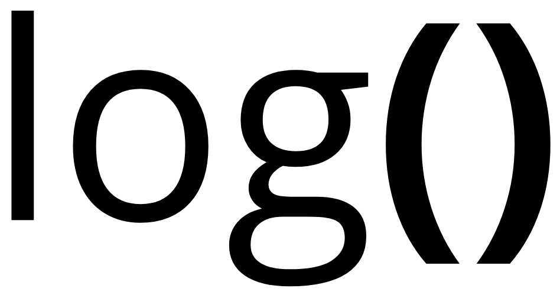

# Prompt — reproduire à l'identique le site « Log » (console de logs d'erreur + agents)

Tu vas construire, depuis zéro, un site statique nommé **Log**. Aucune connaissance préalable de ce projet n'est supposée : tout ce qui est nécessaire est dans ce prompt. Le résultat doit être **identique au pixel et au comportement** à la spécification ci-dessous.

## 1. Rôle et objectif

Créer une page unique (plus une page de préviews) qui :

- affiche un **terminal** de logs qui défilent en continu, très réaliste, sur fond **blanc brillant** ;
- possède un bouton **« Lancer un log d'erreur »** à droite du bandeau supérieur ;
- à chaque clic, provoque une **vraie exception JavaScript**, l'affiche comme **erreur détectée** dans le terminal (carte détaillée : message + pile d'appels) ;
- **crée automatiquement un agent** de correction, affiché dans un **second panneau à droite** du terminal, avec un symbole animé qui travaille, l'état d'avancement, et le log d'erreur qu'il traite ;
- utilise le **rouge doux** comme seul accent, jamais agressif, sur fond blanc.

Contraintes absolues :

- **Vanilla uniquement** : HTML + CSS + JS, aucun framework, aucun bundler, aucune dépendance npm, aucun build. Le site doit fonctionner en ouvrant `index.html` en `file://`.
- Polices via Google Fonts : `Inter` (400,500,600,700) et `JetBrains Mono` (400,500,600).
- Aucune couleur bleue, aucun fond sombre, aucune image de fond bitmap (les fonds sont en CSS, sauf le canvas du fond « espace »).
- Interface en **français**, ton sobre et technique, pas d'emoji.
- Respecter `prefers-reduced-motion` (toutes les animations coupées).

## 2. Arborescence à produire

```
Log/
├── index.html
├── previews.html
├── styles.css
├── app.js
├── bg.js
├── logo.png
├── logo-detoure.png
├── logo-red.png
├── favicon.png
├── apple-touch-icon.png
└── .gitignore        # contenu : .vercel
```

## 3. Assets (à récupérer tels quels, sinon le rendu ne sera pas identique)

Télécharge les images depuis le site de référence, elles sont publiques :

```bash
curl -O https://log-errors.vercel.app/logo.png
curl -O https://log-errors.vercel.app/favicon.png
curl -O https://log-errors.vercel.app/apple-touch-icon.png
cp logo.png logo-detoure.png
```

- `logo.png` : logo détouré, fond **transparent**, 929×483 px. Il est affiché à gauche du bandeau, hauteur 30 px (26 px en mobile), largeur automatique, opacité 0.92.
- `favicon.png` : 64×64, **fond blanc plein**, deux parenthèses noires centrées, marge 5 px.
- `apple-touch-icon.png` : 180×180, même composition.

Si les URL ne sont pas accessibles, reconstruire les assets ainsi :

1. Partir d'une image carrée du logo (fond blanc, trait noir).
2. Détourer par luminance : pour chaque pixel, `alpha = 255 - (0.299R + 0.587G + 0.114B)`, seuils `alpha < 10 → 0`, puis forcer `R=G=B=0` ; recadrer sur la boîte englobante des pixels `alpha > 20` avec 8 px de marge.
3. Pour le favicon : recadrer la zone des parenthèses (environ `x=646, y=26, w=281, h=413` sur l'image détourée), la dessiner centrée sur un carré blanc avec 5 px de marge, en `HighQualityBicubic`, et exporter en 64×64 et 180×180.
4. Variante rouge du logo : même alpha, couleur `rgb(207, 59, 52)`.

## 4. Design system (valeurs exactes, à ne pas arrondir)

```css
--paper:#fdfcfb; --ink:#1a1614; --ink-2:#57504c; --ink-3:#928a85;
--line:rgba(26,22,20,.09); --line-soft:rgba(26,22,20,.06);
--red:#c8382f; --red-deep:#a52a23; --red-soft:#fbe9e7; --red-line:rgba(200,56,47,.22);
--amber:#a9761f; --ok:#2f7d5f; --radius:20px;
```

- Corps : `Inter`, fond `var(--paper)`, texte `var(--ink)`, `-webkit-font-smoothing: antialiased`.
- **Bandeau** : `position: sticky; top: 0; z-index: 30`, `background: rgba(255,255,255,.34)`, `backdrop-filter: blur(26px) saturate(180%)`, bordure basse `1px solid rgba(26,22,20,.07)`, padding `11px clamp(16px,4vw,40px)`, logo à gauche, actions à droite.
- **Boutons en pilule** (style ElevenLabs) : `border-radius: 999px`, `padding: 12px 20px`, `font-size: 13.5px`, `font-weight: 500`, `letter-spacing: -0.01em`, `gap: 8px`, icône SVG 15 px.
  - Primaire : dégradé `linear-gradient(180deg,#d2463d,#bd3129)`, bordure `rgba(150,32,26,.35)`, texte blanc, ombre `0 10px 24px -12px rgba(200,56,47,.75)` + liseré interne blanc 22 % ; hover `linear-gradient(180deg,#db5147,#c63a31)`.
  - Fantôme : fond `rgba(255,255,255,.66)`, bordure `rgba(26,22,20,.1)`, texte `--ink-2` ; hover fond blanc.
  - Petit : `padding: 8px 14px; font-size: 12px`.
  - `:focus-visible` → `box-shadow: 0 0 0 3px rgba(200,56,47,.18)`.
- **Deux rectangles côte à côte** : `.workspace` en grille `minmax(0,1fr) 372px`, `gap: 16px`, largeur `min(1020px,100%)`, centré, padding `clamp(14px,2.6vw,28px) clamp(12px,3vw,24px)` ; terminal et panneau agents ont la même hauteur `min(660px, calc(100vh - 148px))`. Sous 900 px : une colonne, terminal `min(560px,62vh)`, panneau `340px`. Sous 640 px : terminal `min(520px,58vh)`, panneau `320px`, rayons 16 px.
- **Surfaces vitrées** : fond `rgba(255,255,255,.74)` (terminal) et `.62` (panneau), `backdrop-filter: blur(22px) saturate(150%)`, bordure `1px solid rgba(26,22,20,.08)`, ombres `inset 0 1px 0 rgba(255,255,255,.9), 0 1px 2px rgba(60,30,24,.04), 0 30px 70px -38px rgba(80,34,28,.42)`.

## 5. Les cinq fonds (sélecteur `?bg=`)

`bg.js` lit `?bg=` et écrit `document.body.dataset.bg` (valeurs autorisées : `gloss`, `space`, `aurora`, `topo`, `halo`). **Défaut = `halo`** (`<body data-bg="halo">`).

Le fond est un `.bg-stage` fixe (`position: fixed; inset: 0; z-index: 0; pointer-events: none`) contenant : `<canvas id="warp" data-warp></canvas>`, un `.veil` (`linear-gradient(180deg, rgba(255,255,255,.75), transparent 34%)`), et deux pseudo-éléments : `::before` (les halos, opacité 0 par défaut) et `::after` (grain SVG en `feTurbulence` baseFrequency 0.85, `mix-blend-mode: multiply`, opacité 0 par défaut).

1. **`gloss` — blanc laqué** : fond `radial-gradient(120% 80% at 50% -20%, #fff 0%, #fdfbfa 46%, #f7f2f0 100%)` ; `::before` opacité 1 avec deux halos rouges (`rgba(200,56,47,.11)` en haut à droite 38×34 % à 82/8 %, `rgba(200,56,47,.07)` en bas à gauche) + un reflet `linear-gradient(112deg, transparent 38%, rgba(255,255,255,.85) 47%, transparent 56%)` ; grain 0.14.
2. **`space` — espace déformé** : même fond clair, le canvas devient visible (`display: block`, opacité .85) et dessine une grille ondulante animée (voir `bg.js`) ; grain 0.1.
3. **`aurora` — aurore rouge** : `linear-gradient(180deg,#fffdfc,#fbf6f4 60%,#f7efed)` ; trois halos rouges/saumon flous (`filter: blur(28px)`) animés `aurora 28s ease-in-out infinite alternate` (translation + scale) ; grain 0.12.
4. **`topo` — topographie** : deux `repeating-radial-gradient` de traits rouges (pas 26 px et 22 px) masqués par `radial-gradient(90% 70% at 50% 40%, #000 20%, transparent 78%)`, animation `topo 34s linear infinite alternate` ; grain 0.1.
5. **`halo` — halo au curseur (défaut)** : fond `radial-gradient(120% 90% at 50% -10%, #fff, #fbf7f6 55%, #f6efed 100%)` ; `::before` en `inset: 0` avec `radial-gradient(460px circle at var(--mx,50%) var(--my,20%), rgba(200,56,47,.14), rgba(200,56,47,.05) 40%, transparent 70%)` ; les variables `--mx/--my` sont animées en JS (lerp 0.16, `requestAnimationFrame`, uniquement si `pointer: fine`) ; grain 0.12.

Le canvas du fond « espace » : grille de pas 52 px (34 px sous 700 px de large), lignes verticales décalées par `sin(y*0.011 + t*0.55)*gap*0.34 + sin(y*0.026 - t*0.8)*gap*0.14`, lignes horizontales par `sin(x*0.009 + t*0.45)*gap*0.3 + sin(x*0.02 + t*0.7)*gap*0.12` ; une ligne sur quatre est plus marquée (`rgba(200,56,47,.14)` vs `.065` vertical, `.12` vs `.055` horizontal) ; `devicePixelRatio` plafonné à 2 ; boucle stoppée quand l'onglet est caché.

## 6. Terminal (panneau de gauche)

- En-tête : trois pastilles (`#f0a49f`, `#f0cf9f`, `#a9d6bd`, 9 px), titre centré `log@vercel — ~/logs`, à droite `live` en petites capitales avec un point rouge pulsé (`pulse 2.6s`).
- Corps scrollable (`overscroll-behavior: contain`), scrollbar fine translucide.
- Une ligne de log = grille `92px 42px minmax(0,1fr)`, `column-gap: 10px`, `padding: 3px 14px`, `font-size: 11.5px`, `line-height: 1.5`, animation d'entrée `rowIn .18s`.
  - horodatage `HH:MM:SS.mmm` (chiffres tabulaires, `font-variant-numeric: tabular-nums`, `white-space: nowrap`, couleur `#a9a19c`, 10.5 px) ;
  - badge de niveau 3 lettres en majuscules (`dbg`, `inf`, `wrn`, `ok`, `err`), 9 px, pastille arrondie 5 px ;
  - message en `JetBrains Mono` avec `overflow-wrap: anywhere`.
  - Couleurs : `err` → badge `#a52a23` sur `#fbe9e7`, texte `#8f2f28` ; `wrn` → `#a9761f` sur `#fbf1de`, texte `#8a6318` ; `ok` → `#2f7d5f` sur `#e7f3ed`.
  - **Les colonnes sont fixes : aucun chevauchement possible entre l'horodatage, le badge et le message.**
- Pied : `N lignes · <statut> … UTF-8 · HH:MM:SS` en 9.5 px majuscules espacées.
- Mobile (≤640 px) : grille `78px 38px 1fr`, police 11 px, padding 3px 10px.

## 7. Erreur détectée (dans le terminal)

Au clic sur le bouton (ou touche `Entrée` sur `body`) :

1. une ligne `err` est ajoutée : `POST /api/checkout → 500 · <CODE>` ;
2. une des quatre fonctions suivantes est exécutée pour lever une **vraie** exception : `payload.order.items.length` sur `{orderId:null}` (`ERR_PAYLOAD_INVALID`) ; `session.refreshToken()` sur `{}` (`ERR_UNDEFINED_CALL`) ; `JSON.parse('{"user": "gaia", }')` (`ERR_PARSE_FAILED`) ; `buffer[12].toString()` sur `[1,2,3]` (`ERR_RANGE_OVERFLOW`) — en rotation ;
3. la carte d'erreur est insérée dans le flux : fond `linear-gradient(180deg, rgba(255,250,249,.95), rgba(255,245,243,.9))`, bordure `rgba(200,56,47,.22)`, rayon 16 px, marges `9px 12px 11px`, animation d'entrée + **halo rouge** `errGlow 1.6s` via `[data-fresh="true"]` (remis à `false` après 2 s) ;
4. contenu de la carte : icône `!` sur `#f8dbd7`, nom de l'erreur (`TypeError`, `SyntaxError`…), sous-titre `<CODE> · trace <6 hex>`, heure, message en mono rouge `#7a2c25`, **pile d'appels** dans un `<pre>` gris (10 px, max-height 92 px), puis **uniquement** un bouton fantôme « Copier la trace » (copie `[CODE] Name: message` + stack via `navigator.clipboard`, feedback « Copié » 1,5 s) ;
5. le statut du terminal passe à `erreur détectée` ;
6. **il n'existe aucun bouton « Créer un agent »** : l'agent est créé automatiquement **380 ms** plus tard.

Les handlers globaux `error` et `unhandledrejection` créent la même carte (codes `ERR_UNCAUGHT`, `ERR_UNHANDLED_REJECTION`).

## 8. Panneau agents (rectangle de droite)

- En-tête : titre `agents`, sous-titre mono `surveillance des erreurs`, compteur à droite `N actif(s)` (rouge quand > 0, gris sinon).
- Pied : point rouge + `veille active · N erreur(s)`.
- État vide : orbe en pointillés rouges + `aucun agent` / `en attente d'incident`.
- **Une carte par erreur**, empilées avec **la plus récente en haut**, **3 maximum** (les plus anciennes sont retirées avec leurs timers). Chaque carte contient :
  - un **symbole d'agent animé** : disque 28 px en `conic-gradient` rouge qui tourne (`orbSpin 2.2s linear infinite`), cœur clair en `::before`, point rouge lumineux en orbite en `::after`, pastille centrale qui respire (`orbBreathe 1.9s`) ;
  - le nom `agent/fix-<code>` (code en minuscules, `ERR_` retiré, `_` → `-`) ;
  - la ligne mono `<CODE> · <trace>` ;
  - une pastille d'état : `analyse` → `correctif` → `vérification` → `prêt` (rouge, puis verte `#2f7d5f` sur `#e7f3ed` à la fin) ;
  - **quatre segments de progression** : gris, puis rouge plein pour les étapes faites, et un segment animé (`barSweep 1.1s`) pour l'étape en cours ;
  - **le log d'erreur traité** : encart mono `err · <CODE> · <message>`, fond `rgba(200,56,47,.055)`, bordure `rgba(200,56,47,.14)`, texte `#8f2f28`, 2 lignes max ; à la fin il devient vert `ok · patch appliqué · tests 12/12 · <CODE>`.
- Cycle : création → ligne `inf` dans le terminal `agent/fix-<slug> créé · <CODE> · <trace>` → une étape toutes les `900 + random*700` ms → à la fin : ligne `ok` `patch appliqué · <CODE> · tests 12/12`, statut terminal `correctif prêt`, compteur `0 actif`, carte en `data-state="done"` (animations du symbole stoppées, bordure verte).

## 9. Flux continu

Un log simulé est ajouté toutes les `650–1900 ms` (plus rapide, `120–380 ms`, dans 10 % des cas) parmi : `GET/POST <route> <code> · <ms> ms`, `cache hit|miss|revalidate · key=…`, `worker ready · region=cdg1|fra1|iad1 · pid=…`, `queue consume · batch=… · lag=… ms`, `deploy ready · dpl_<9 hex>`, `slow query · … (seuil 400 ms)`, `trace <16 hex> · sampled=0.x`, `WS /socket connected · clients=…`. Routes : `/api/health`, `/api/session`, `/api/logs`, `/api/metrics`, `/api/checkout`, `/api/profile`, `/api/events`. Le flux est plafonné à 160 lignes (les plus anciennes sont supprimées) et ne force le défilement que si l'utilisateur est déjà en bas (< 80 px du bas).

Au chargement : `session attachée · tail -f /var/log/app.log` (`inf`), `handlers error et unhandledrejection actifs` (`ok`), compteur agents `0 actif`, pied `veille active · 0 erreur`. `?demo=error` déclenche une erreur après 600 ms.

## 10. Page `previews.html`

Même charte, fond `halo`, sans logique de logs :

- en-tête : logo 26 px, `fonds & états`, bouton « Retour au site » ;
- titre `Cinq fonds, deux moments.` + paragraphe ;
- grille de 5 cartes cliquables (vignette 186 px reproduisant chaque fond + mini-terminal + numéro `01`–`05` + nom + badge `défaut` sur `Halo au curseur`), liens vers `index.html?bg=<clé>` ;
- section « Quand une erreur est détectée — terminal + agent » : deux maquettes statiques côte à côte (terminal + panneau agents) montrant l'état **erreur détectée / agent en analyse** puis **correctif prêt / 0 actif** ;
- encadré final rappelant `index.html?demo=error` et le fond par défaut.

## 11. Livraison

```bash
git init -b main
git add -A
git commit -m "Site Log: terminal de logs, erreurs detectees, agents de correction"
gh repo create <compte>/Log --public --source . --remote origin --push
npx vercel@latest deploy --prod --yes --name log-errors
```

## 12. Critères d'acceptation (à vérifier avant de répondre)

1. `index.html` ouvert en local : logs qui défilent, bandeau blanc translucide, halo rouge qui suit le curseur.
2. Clic sur « Lancer un log d'erreur » : ligne `err`, carte détaillée avec pile d'appels et **halo rouge**, statut `erreur détectée`, puis **agent créé sans aucune action** dans le panneau de droite.
3. L'agent progresse seul (`analyse` → `correctif` → `vérification` → `prêt`), ses 4 segments se remplissent, et le terminal finit par afficher `patch appliqué · … · tests 12/12`.
4. Aucun bouton « Créer un agent », aucune notion d'épinglage, aucune couleur bleue, aucun fond sombre.
5. Horodatages jamais chevauchés par le badge ni par le message, à toutes les largeurs.
6. Favicon : deux parenthèses noires centrées sur carré blanc.
7. `?bg=gloss|space|aurora|topo|halo` change le fond ; `halo` par défaut ; `?demo=error` fonctionne.
8. `node --check app.js` et `node --check bg.js` passent.

## 13. Fichiers (copie intégrale, à reproduire caractère pour caractère)

Les blocs ci-dessous sont la source exacte. Ne rien renommer, ne rien « améliorer », ne pas reformater. Conserver l'indentation, l'ordre des règles CSS et l'ordre des déclarations.

### `index.html`

```html
<!DOCTYPE html>
<html lang="fr">
<head>
  <meta charset="UTF-8" />
  <meta name="viewport" content="width=device-width, initial-scale=1.0" />
  <title>Log — Console de test d'erreurs</title>
  <meta name="description" content="Déclenchez un log d'erreur et regardez un agent le résoudre." />
  <link rel="preconnect" href="https://fonts.googleapis.com" />
  <link rel="preconnect" href="https://fonts.gstatic.com" crossorigin />
  <link href="https://fonts.googleapis.com/css2?family=Inter:wght@400;500;600;700&family=JetBrains+Mono:wght@400;500;600&display=swap" rel="stylesheet" />
  <link rel="stylesheet" href="styles.css" />
  <link rel="icon" href="favicon.png" type="image/png" />
  <link rel="apple-touch-icon" href="apple-touch-icon.png" />
</head>
<body data-bg="halo">
  <div class="bg-stage" aria-hidden="true">
    <canvas id="warp" data-warp></canvas>
    <div class="veil"></div>
  </div>

  <header class="topbar">
    <a class="brand" href="/" aria-label="Log">
      
    </a>

    <div class="topbar-actions">
      <a class="btn btn-ghost" href="previews.html">Fonds &amp; états</a>
      <button id="fire" class="btn btn-primary" type="button">
        <svg viewBox="0 0 24 24" aria-hidden="true"><path d="M13 2 4.5 13.5H11l-1 8.5L19.5 10H13l0-8Z"/></svg>
        Lancer un log d'erreur
      </button>
    </div>
  </header>

  <main class="workspace">
    <section class="terminal" aria-label="Terminal de logs">
      <header class="term-head">
        <span class="traffic" aria-hidden="true"><i></i><i></i><i></i></span>
        <span class="term-title">log@vercel — ~/logs</span>
        <span class="term-live"><i></i>live</span>
      </header>

      <div id="stream" class="term-body" role="log" aria-live="polite"></div>

      <footer class="term-foot">
        <span id="count">0 ligne</span>
        <span class="sep">·</span>
        <span id="status">en attente</span>
        <span class="foot-right">
          <span>UTF-8</span>
          <span class="sep">·</span>
          <span id="clock">--:--:--</span>
        </span>
      </footer>
    </section>

    <aside class="agents" aria-label="Agents de correction">
      <header class="agents-head">
        <div class="agents-titles">
          <strong>agents</strong>
          <span>surveillance des erreurs</span>
        </div>
        <span id="agentCount" class="agents-count">0 actif</span>
      </header>

      <div id="agentList" class="agents-body">
        <div id="agentsEmpty" class="agents-empty">
          <span class="agents-empty-orb" aria-hidden="true"></span>
          <p>aucun agent</p>
          <span>en attente d'incident</span>
        </div>
      </div>

      <footer class="agents-foot">
        <span class="dotline" aria-hidden="true"></span>
        <span id="agentFoot">veille active · 0 erreur</span>
      </footer>
    </aside>
  </main>

  <script src="bg.js"></script>
  <script src="app.js"></script>
</body>
</html>
```

### `styles.css`

```css
:root {
  --paper: #fdfcfb;
  --ink: #1a1614;
  --ink-2: #57504c;
  --ink-3: #928a85;
  --line: rgba(26, 22, 20, 0.09);
  --line-soft: rgba(26, 22, 20, 0.06);
  --red: #c8382f;
  --red-deep: #a52a23;
  --red-soft: #fbe9e7;
  --red-line: rgba(200, 56, 47, 0.22);
  --amber: #a9761f;
  --ok: #2f7d5f;
  --radius: 20px;
}

* { box-sizing: border-box; }

html, body { margin: 0; padding: 0; }

body {
  min-height: 100vh;
  background: var(--paper);
  color: var(--ink);
  font-family: "Inter", system-ui, -apple-system, "Segoe UI", sans-serif;
  -webkit-font-smoothing: antialiased;
  text-rendering: optimizeLegibility;
  display: flex;
  flex-direction: column;
  overflow-x: hidden;
}

/* ------------------------------------------------------------------ */
/* Fonds                                                               */
/* ------------------------------------------------------------------ */

.bg-stage {
  position: fixed;
  inset: 0;
  z-index: 0;
  overflow: hidden;
  pointer-events: none;
  background: var(--paper);
}

.bg-stage::before {
  content: "";
  position: absolute;
  inset: -12%;
  opacity: 0;
  transition: opacity 0.7s ease;
  will-change: transform;
}

.bg-stage::after {
  content: "";
  position: absolute;
  inset: 0;
  opacity: 0;
  transition: opacity 0.7s ease;
  background-image: url("data:image/svg+xml,%3Csvg xmlns='http://www.w3.org/2000/svg' width='160' height='160'%3E%3Cfilter id='n'%3E%3CfeTurbulence type='fractalNoise' baseFrequency='0.85' numOctaves='3'/%3E%3C/filter%3E%3Crect width='160' height='160' filter='url(%23n)' opacity='0.5'/%3E%3C/svg%3E");
  mix-blend-mode: multiply;
}

#warp {
  position: absolute;
  inset: 0;
  width: 100%;
  height: 100%;
  display: none;
  opacity: 0.85;
}

/* 1 — blanc laqué (défaut) */
body[data-bg="gloss"] .bg-stage {
  background:
    radial-gradient(120% 80% at 50% -20%, #ffffff 0%, #fdfbfa 46%, #f7f2f0 100%);
}
body[data-bg="gloss"] .bg-stage::before {
  opacity: 1;
  background:
    radial-gradient(38% 34% at 82% 8%, rgba(200, 56, 47, 0.11), transparent 70%),
    radial-gradient(46% 40% at 12% 96%, rgba(200, 56, 47, 0.07), transparent 72%),
    linear-gradient(112deg, transparent 38%, rgba(255, 255, 255, 0.85) 47%, transparent 56%);
}
body[data-bg="gloss"] .bg-stage::after { opacity: 0.14; }

/* 2 — espace déformé */
body[data-bg="space"] .bg-stage {
  background: radial-gradient(130% 90% at 50% -10%, #ffffff 0%, #fcf9f8 50%, #f6f1ef 100%);
}
body[data-bg="space"] #warp { display: block; }
body[data-bg="space"] .bg-stage::after { opacity: 0.1; }

/* 3 — aurore rouge */
body[data-bg="aurora"] .bg-stage {
  background: linear-gradient(180deg, #fffdfc, #fbf6f4 60%, #f7efed);
}
body[data-bg="aurora"] .bg-stage::before {
  opacity: 1;
  background:
    radial-gradient(42% 46% at 18% 18%, rgba(200, 56, 47, 0.16), transparent 70%),
    radial-gradient(38% 42% at 84% 12%, rgba(255, 138, 110, 0.2), transparent 72%),
    radial-gradient(52% 48% at 62% 94%, rgba(200, 56, 47, 0.1), transparent 74%);
  filter: blur(28px);
  animation: aurora 28s ease-in-out infinite alternate;
}
body[data-bg="aurora"] .bg-stage::after { opacity: 0.12; }

@keyframes aurora {
  0% { transform: translate3d(-2%, -1%, 0) scale(1); }
  50% { transform: translate3d(2%, 2%, 0) scale(1.06); }
  100% { transform: translate3d(-1%, 1%, 0) scale(1.02); }
}

/* 4 — topographie */
body[data-bg="topo"] .bg-stage {
  background: linear-gradient(160deg, #ffffff, #fcf8f7 60%, #f8f2f0);
}
body[data-bg="topo"] .bg-stage::before {
  opacity: 1;
  background:
    repeating-radial-gradient(circle at 26% 18%, rgba(200, 56, 47, 0.13) 0 1px, transparent 1px 26px),
    repeating-radial-gradient(circle at 78% 84%, rgba(200, 56, 47, 0.1) 0 1px, transparent 1px 22px);
  -webkit-mask-image: radial-gradient(90% 70% at 50% 40%, #000 20%, transparent 78%);
  mask-image: radial-gradient(90% 70% at 50% 40%, #000 20%, transparent 78%);
  animation: topo 34s linear infinite alternate;
}
body[data-bg="topo"] .bg-stage::after { opacity: 0.1; }

@keyframes topo {
  from { transform: translate3d(-1.5%, -1%, 0) scale(1.02); }
  to { transform: translate3d(1.5%, 1.5%, 0) scale(1.06); }
}

/* 5 — halo au curseur */
body[data-bg="halo"] .bg-stage {
  background: radial-gradient(120% 90% at 50% -10%, #ffffff, #fbf7f6 55%, #f6efed 100%);
}
body[data-bg="halo"] .bg-stage::before {
  opacity: 1;
  inset: 0;
  background: radial-gradient(
    460px circle at var(--mx, 50%) var(--my, 20%),
    rgba(200, 56, 47, 0.14),
    rgba(200, 56, 47, 0.05) 40%,
    transparent 70%
  );
}
body[data-bg="halo"] .bg-stage::after { opacity: 0.12; }

.veil {
  position: absolute;
  inset: 0;
  background: linear-gradient(180deg, rgba(255, 255, 255, 0.75), rgba(255, 255, 255, 0) 34%);
}

/* ------------------------------------------------------------------ */
/* Bandeau                                                             */
/* ------------------------------------------------------------------ */

.topbar {
  position: sticky;
  top: 0;
  z-index: 30;
  display: flex;
  align-items: center;
  justify-content: space-between;
  gap: 16px;
  padding: 11px clamp(16px, 4vw, 40px);
  background: rgba(255, 255, 255, 0.34);
  -webkit-backdrop-filter: blur(26px) saturate(180%);
  backdrop-filter: blur(26px) saturate(180%);
  border-bottom: 1px solid rgba(26, 22, 20, 0.07);
}

.brand {
  display: flex;
  align-items: center;
  text-decoration: none;
  min-width: 0;
}

.brand-logo {
  display: block;
  height: 30px;
  width: auto;
  max-width: 170px;
  object-fit: contain;
  opacity: 0.92;
}

.topbar-actions {
  display: flex;
  align-items: center;
  gap: 8px;
}

/* ------------------------------------------------------------------ */
/* Boutons — pilules                                                   */
/* ------------------------------------------------------------------ */

.btn {
  display: inline-flex;
  align-items: center;
  justify-content: center;
  gap: 8px;
  font: inherit;
  font-size: 13.5px;
  font-weight: 500;
  letter-spacing: -0.01em;
  line-height: 1;
  padding: 12px 20px;
  border-radius: 999px;
  border: 1px solid transparent;
  cursor: pointer;
  text-decoration: none;
  white-space: nowrap;
  transition: background 0.18s ease, border-color 0.18s ease, box-shadow 0.18s ease, transform 0.18s ease, color 0.18s ease;
}

.btn:active { transform: translateY(0.5px) scale(0.995); }

.btn:focus-visible {
  outline: none;
  box-shadow: 0 0 0 3px rgba(200, 56, 47, 0.18);
}

.btn-primary {
  color: #fff;
  background: linear-gradient(180deg, #d2463d, #bd3129);
  border-color: rgba(150, 32, 26, 0.35);
  box-shadow:
    0 10px 24px -12px rgba(200, 56, 47, 0.75),
    inset 0 1px 0 rgba(255, 255, 255, 0.22);
}

.btn-primary:hover {
  background: linear-gradient(180deg, #db5147, #c63a31);
}

.btn-ghost {
  color: var(--ink-2);
  background: rgba(255, 255, 255, 0.66);
  border-color: rgba(26, 22, 20, 0.1);
  box-shadow: 0 1px 2px rgba(26, 22, 20, 0.04);
}

.btn-ghost:hover {
  background: #fff;
  border-color: rgba(26, 22, 20, 0.18);
  color: var(--ink);
}

.btn svg {
  width: 15px;
  height: 15px;
  fill: currentColor;
  flex: 0 0 auto;
}

.btn-sm {
  padding: 8px 14px;
  font-size: 12px;
  gap: 6px;
}

.btn-sm svg { width: 13px; height: 13px; }

.btn[disabled] {
  opacity: 0.45;
  cursor: default;
  pointer-events: none;
}

/* ------------------------------------------------------------------ */
/* Terminal                                                            */
/* ------------------------------------------------------------------ */

.workspace {
  position: relative;
  z-index: 1;
  flex: 1 1 auto;
  width: min(1020px, 100%);
  margin: 0 auto;
  padding: clamp(14px, 2.6vw, 28px) clamp(12px, 3vw, 24px) clamp(18px, 3vw, 28px);
  min-height: 0;
  display: grid;
  grid-template-columns: minmax(0, 1fr) 372px;
  gap: 16px;
  align-items: stretch;
}

.terminal {
  min-width: 0;
  height: min(660px, calc(100vh - 148px));
  display: flex;
  flex-direction: column;
  border-radius: var(--radius);
  background: rgba(255, 255, 255, 0.74);
  -webkit-backdrop-filter: blur(22px) saturate(150%);
  backdrop-filter: blur(22px) saturate(150%);
  border: 1px solid rgba(26, 22, 20, 0.08);
  box-shadow:
    inset 0 1px 0 rgba(255, 255, 255, 0.9),
    0 1px 2px rgba(60, 30, 24, 0.04),
    0 30px 70px -38px rgba(80, 34, 28, 0.42);
  overflow: hidden;
}

.term-head {
  flex: 0 0 auto;
  display: grid;
  grid-template-columns: auto 1fr auto;
  align-items: center;
  gap: 12px;
  padding: 10px 14px;
  border-bottom: 1px solid var(--line-soft);
  background: rgba(255, 255, 255, 0.5);
  font-family: "JetBrains Mono", ui-monospace, monospace;
  font-size: 11px;
  color: var(--ink-3);
}

.traffic { display: inline-flex; gap: 6px; }

.traffic i {
  width: 9px;
  height: 9px;
  border-radius: 50%;
  background: #e2ddd9;
}

.traffic i:first-child { background: #f0a49f; }
.traffic i:nth-child(2) { background: #f0cf9f; }
.traffic i:nth-child(3) { background: #a9d6bd; }

.term-title {
  justify-self: center;
  color: var(--ink-3);
  letter-spacing: -0.01em;
  overflow: hidden;
  text-overflow: ellipsis;
  white-space: nowrap;
}

.term-live {
  display: inline-flex;
  align-items: center;
  gap: 6px;
  font-size: 9.5px;
  letter-spacing: 0.12em;
  text-transform: uppercase;
  color: var(--ink-3);
}

.term-live i {
  width: 6px;
  height: 6px;
  border-radius: 50%;
  background: var(--red);
  box-shadow: 0 0 0 3px rgba(200, 56, 47, 0.12);
  animation: pulse 2.6s ease-in-out infinite;
}

@keyframes pulse {
  0%, 100% { opacity: 1; }
  50% { opacity: 0.35; }
}

.term-body {
  flex: 1 1 auto;
  min-height: 0;
  overflow-y: auto;
  overflow-x: hidden;
  padding: 10px 0 14px;
  scrollbar-width: thin;
  scrollbar-color: rgba(26, 22, 20, 0.16) transparent;
  overscroll-behavior: contain;
}

.term-body::-webkit-scrollbar { width: 9px; }
.term-body::-webkit-scrollbar-track { background: transparent; }
.term-body::-webkit-scrollbar-thumb {
  background: rgba(26, 22, 20, 0.14);
  border: 3px solid transparent;
  background-clip: content-box;
  border-radius: 9px;
}

.row {
  display: grid;
  grid-template-columns: 92px 42px minmax(0, 1fr);
  align-items: start;
  column-gap: 10px;
  padding: 3px 14px;
  font-family: "JetBrains Mono", ui-monospace, monospace;
  font-size: 11.5px;
  line-height: 1.5;
  color: var(--ink-2);
  animation: rowIn 0.18s ease both;
}

@keyframes rowIn {
  from { opacity: 0; transform: translateY(-2px); }
  to { opacity: 1; transform: none; }
}

.row:hover { background: rgba(26, 22, 20, 0.025); }

.row time {
  color: #a9a19c;
  font-size: 10.5px;
  font-variant-numeric: tabular-nums;
  white-space: nowrap;
  overflow: hidden;
  text-overflow: clip;
  padding-top: 2px;
}

.lvl {
  justify-self: start;
  font-size: 9px;
  font-weight: 600;
  letter-spacing: 0.08em;
  text-transform: uppercase;
  padding: 2px 5px;
  border-radius: 5px;
  line-height: 1.35;
  color: var(--ink-3);
  background: rgba(26, 22, 20, 0.05);
  margin-top: 1px;
}

.row[data-level="err"] .lvl { color: var(--red-deep); background: var(--red-soft); }
.row[data-level="wrn"] .lvl { color: var(--amber); background: #fbf1de; }
.row[data-level="ok"] .lvl { color: var(--ok); background: #e7f3ed; }

.row[data-level="err"] .msg { color: #8f2f28; }
.row[data-level="wrn"] .msg { color: #8a6318; }

.msg {
  min-width: 0;
  overflow-wrap: anywhere;
  word-break: break-word;
}

/* ------------------------------------------------------------------ */
/* Cartes erreur / agent                                               */
/* ------------------------------------------------------------------ */

.card {
  margin: 9px 12px 11px;
  border-radius: 16px;
  background: rgba(255, 255, 255, 0.82);
  border: 1px solid var(--line);
  box-shadow: 0 16px 34px -26px rgba(70, 30, 24, 0.5);
  animation: cardIn 0.26s cubic-bezier(0.2, 0.8, 0.2, 1) both;
  overflow: hidden;
}

@keyframes cardIn {
  from { opacity: 0; transform: translateY(6px) scale(0.995); }
  to { opacity: 1; transform: none; }
}

.card-error {
  background: linear-gradient(180deg, rgba(255, 250, 249, 0.95), rgba(255, 245, 243, 0.9));
  border-color: var(--red-line);
}

.card-head {
  display: flex;
  align-items: center;
  gap: 10px;
  padding: 11px 13px 0;
}

.card-icon {
  flex: 0 0 auto;
  width: 26px;
  height: 26px;
  display: grid;
  place-items: center;
  border-radius: 8px;
  background: #f8dbd7;
  color: var(--red-deep);
  font-size: 13px;
  font-weight: 700;
  font-family: "JetBrains Mono", monospace;
}

.card-titles { min-width: 0; flex: 1 1 auto; display: grid; gap: 1px; }

.card-titles strong {
  font-size: 12.5px;
  font-weight: 600;
  letter-spacing: -0.01em;
  color: var(--ink);
  overflow: hidden;
  text-overflow: ellipsis;
  white-space: nowrap;
}

.card-sub {
  font-family: "JetBrains Mono", ui-monospace, monospace;
  font-size: 10px;
  color: var(--ink-3);
  overflow: hidden;
  text-overflow: ellipsis;
  white-space: nowrap;
}

.card-head time {
  font-family: "JetBrains Mono", monospace;
  font-size: 10px;
  color: #b3aaa4;
  font-variant-numeric: tabular-nums;
  flex: 0 0 auto;
}

.card-msg {
  margin: 8px 13px 0;
  font-family: "JetBrains Mono", ui-monospace, monospace;
  font-size: 11.5px;
  line-height: 1.55;
  color: #7a2c25;
  overflow-wrap: anywhere;
}

.card-stack {
  margin: 9px 13px 0;
  padding: 9px 10px;
  border-radius: 9px;
  background: rgba(26, 22, 20, 0.035);
  border: 1px solid var(--line-soft);
  color: #6f6662;
  font-family: "JetBrains Mono", ui-monospace, monospace;
  font-size: 10px;
  line-height: 1.6;
  white-space: pre-wrap;
  overflow: auto;
  max-height: 92px;
}

.card-actions {
  display: flex;
  flex-wrap: wrap;
  gap: 7px;
  padding: 11px 13px 12px;
}

/* ------------------------------------------------------------------ */
/* Panneau agents                                                      */
/* ------------------------------------------------------------------ */

.agents {
  min-width: 0;
  height: min(660px, calc(100vh - 148px));
  display: flex;
  flex-direction: column;
  border-radius: var(--radius);
  background: rgba(255, 255, 255, 0.62);
  -webkit-backdrop-filter: blur(22px) saturate(150%);
  backdrop-filter: blur(22px) saturate(150%);
  border: 1px solid rgba(26, 22, 20, 0.08);
  box-shadow:
    inset 0 1px 0 rgba(255, 255, 255, 0.9),
    0 1px 2px rgba(60, 30, 24, 0.04),
    0 30px 70px -38px rgba(80, 34, 28, 0.38);
  overflow: hidden;
}

.agents-head {
  flex: 0 0 auto;
  display: flex;
  align-items: center;
  gap: 10px;
  padding: 11px 14px;
  border-bottom: 1px solid var(--line-soft);
  background: rgba(255, 255, 255, 0.5);
}

.agents-titles { display: grid; gap: 1px; min-width: 0; }

.agents-titles strong {
  font-size: 12.5px;
  font-weight: 600;
  letter-spacing: -0.01em;
  color: var(--ink);
}

.agents-titles span {
  font-family: "JetBrains Mono", ui-monospace, monospace;
  font-size: 9.5px;
  letter-spacing: 0.04em;
  color: var(--ink-3);
}

.agents-count {
  margin-left: auto;
  flex: 0 0 auto;
  font-family: "JetBrains Mono", ui-monospace, monospace;
  font-size: 9.5px;
  letter-spacing: 0.06em;
  text-transform: uppercase;
  color: var(--ink-3);
  border: 1px solid var(--line-soft);
  background: rgba(255, 255, 255, 0.7);
  border-radius: 999px;
  padding: 4px 9px;
}

.agents-count[data-busy="true"] {
  color: var(--red-deep);
  border-color: var(--red-line);
  background: var(--red-soft);
}

.agents-body {
  flex: 1 1 auto;
  min-height: 0;
  overflow-y: auto;
  padding: 10px;
  display: grid;
  align-content: start;
  gap: 8px;
  scrollbar-width: thin;
  scrollbar-color: rgba(26, 22, 20, 0.16) transparent;
}

.agents-body::-webkit-scrollbar { width: 9px; }
.agents-body::-webkit-scrollbar-track { background: transparent; }
.agents-body::-webkit-scrollbar-thumb {
  background: rgba(26, 22, 20, 0.14);
  border: 3px solid transparent;
  background-clip: content-box;
  border-radius: 9px;
}

.agents-empty {
  display: grid;
  justify-items: center;
  gap: 4px;
  padding: 46px 12px;
  text-align: center;
  color: var(--ink-3);
}

.agents-empty-orb {
  width: 26px;
  height: 26px;
  margin-bottom: 8px;
  border-radius: 50%;
  border: 1px dashed rgba(200, 56, 47, 0.35);
  box-shadow: inset 0 0 0 6px rgba(200, 56, 47, 0.05);
}

.agents-empty[hidden] { display: none; }

.agents-empty p {
  margin: 0;
  font-size: 12px;
  color: var(--ink-2);
}

.agents-empty span:last-child {
  font-family: "JetBrains Mono", monospace;
  font-size: 9.5px;
}

/* Carte agent */

.agent-card {
  border-radius: 14px;
  background: rgba(255, 255, 255, 0.86);
  border: 1px solid var(--line);
  box-shadow: 0 14px 28px -24px rgba(70, 30, 24, 0.5);
  padding: 10px 11px 11px;
  animation: agentIn 0.3s cubic-bezier(0.2, 0.8, 0.2, 1) both;
}

@keyframes agentIn {
  from { opacity: 0; transform: translateY(-8px) scale(0.98); }
  to { opacity: 1; transform: none; }
}

.agent-card[data-state="done"] { border-color: rgba(47, 125, 95, 0.24); }
.agent-card[data-state="done"] .agent-orb { filter: saturate(0.55) brightness(1.05); }

.agent-top {
  display: flex;
  align-items: center;
  gap: 9px;
  min-width: 0;
}

.agent-orb {
  position: relative;
  flex: 0 0 auto;
  width: 28px;
  height: 28px;
  border-radius: 50%;
  display: grid;
  place-items: center;
  background: conic-gradient(from 0deg, rgba(200, 56, 47, 0.05), rgba(200, 56, 47, 0.5), rgba(200, 56, 47, 0.05));
  animation: orbSpin 2.2s linear infinite;
}

.agent-orb::before {
  content: "";
  position: absolute;
  inset: 2.5px;
  border-radius: 50%;
  background: radial-gradient(circle at 34% 30%, #fff, #fdf1ef 45%, #f6dcd8 100%);
  box-shadow: inset 0 1px 1px rgba(255, 255, 255, 0.9);
}

.agent-orb::after {
  content: "";
  position: absolute;
  top: -1px;
  left: 50%;
  width: 5px;
  height: 5px;
  margin-left: -2.5px;
  border-radius: 50%;
  background: var(--red);
  box-shadow: 0 0 6px rgba(200, 56, 47, 0.8);
}

.agent-orb i {
  position: relative;
  z-index: 1;
  width: 9px;
  height: 9px;
  border-radius: 50%;
  background: linear-gradient(160deg, #d2463d, #8e211b);
  box-shadow: 0 0 0 2px rgba(200, 56, 47, 0.14);
  animation: orbBreathe 1.9s ease-in-out infinite;
}

@keyframes orbSpin { to { transform: rotate(360deg); } }

@keyframes orbBreathe {
  0%, 100% { transform: scale(0.82); }
  50% { transform: scale(1.12); }
}

.agent-card[data-state="done"] .agent-orb,
.agent-card[data-state="done"] .agent-orb i {
  animation: none;
}

.agent-meta { min-width: 0; flex: 1 1 auto; display: grid; gap: 1px; }

.agent-name {
  font-size: 11.5px;
  font-weight: 600;
  letter-spacing: -0.01em;
  color: var(--ink);
  overflow: hidden;
  text-overflow: ellipsis;
  white-space: nowrap;
}

.agent-code {
  font-family: "JetBrains Mono", ui-monospace, monospace;
  font-size: 9.5px;
  color: var(--ink-3);
  overflow: hidden;
  text-overflow: ellipsis;
  white-space: nowrap;
}

.agent-state {
  flex: 0 0 auto;
  font-family: "JetBrains Mono", monospace;
  font-size: 8.5px;
  font-weight: 500;
  letter-spacing: 0.08em;
  text-transform: uppercase;
  padding: 3px 7px;
  border-radius: 999px;
  color: var(--red-deep);
  background: var(--red-soft);
  white-space: nowrap;
}

.agent-card[data-state="done"] .agent-state {
  color: var(--ok);
  background: #e7f3ed;
}

.agent-bars {
  display: flex;
  gap: 3px;
  margin-top: 9px;
}

.agent-bars span {
  flex: 1 1 0;
  height: 2.5px;
  border-radius: 2px;
  background: rgba(26, 22, 20, 0.09);
  overflow: hidden;
}

.agent-bars span[data-on="true"] {
  background: linear-gradient(90deg, rgba(200, 56, 47, 0.55), var(--red));
}

.agent-bars span[data-on="run"] {
  background: rgba(200, 56, 47, 0.16);
  position: relative;
}

.agent-bars span[data-on="run"]::after {
  content: "";
  position: absolute;
  inset: 0;
  background: linear-gradient(90deg, transparent, var(--red), transparent);
  animation: barSweep 1.1s ease-in-out infinite;
}

@keyframes barSweep {
  from { transform: translateX(-100%); }
  to { transform: translateX(100%); }
}

.agent-log {
  margin-top: 9px;
  display: flex;
  align-items: flex-start;
  gap: 6px;
  padding: 7px 8px;
  border-radius: 8px;
  background: rgba(200, 56, 47, 0.055);
  border: 1px solid rgba(200, 56, 47, 0.14);
  font-family: "JetBrains Mono", ui-monospace, monospace;
  font-size: 9.5px;
  line-height: 1.5;
  color: #8f2f28;
}

.agent-log b {
  flex: 0 0 auto;
  font-weight: 600;
  color: var(--red-deep);
}

.agent-log span {
  min-width: 0;
  overflow: hidden;
  display: -webkit-box;
  -webkit-line-clamp: 2;
  -webkit-box-orient: vertical;
  overflow-wrap: anywhere;
}

.agent-card[data-state="done"] .agent-log {
  background: rgba(47, 125, 95, 0.06);
  border-color: rgba(47, 125, 95, 0.18);
  color: #2b6a52;
}

.agent-card[data-state="done"] .agent-log b { color: var(--ok); }

.agents-foot {
  flex: 0 0 auto;
  display: flex;
  align-items: center;
  gap: 7px;
  padding: 7px 14px;
  border-top: 1px solid var(--line-soft);
  background: rgba(255, 255, 255, 0.55);
  font-family: "JetBrains Mono", ui-monospace, monospace;
  font-size: 9.5px;
  letter-spacing: 0.06em;
  text-transform: uppercase;
  color: #a9a19c;
}

.dotline {
  width: 5px;
  height: 5px;
  border-radius: 50%;
  background: var(--red);
  box-shadow: 0 0 0 3px rgba(200, 56, 47, 0.12);
}

/* Détection d'erreur */

.card-error[data-fresh="true"] {
  animation: errIn 0.34s cubic-bezier(0.2, 0.8, 0.2, 1) both, errGlow 1.6s ease-out 0.34s;
}

@keyframes errIn {
  from { opacity: 0; transform: translateY(8px) scale(0.99); }
  to { opacity: 1; transform: none; }
}

@keyframes errGlow {
  0% { box-shadow: 0 0 0 0 rgba(200, 56, 47, 0.35), 0 16px 34px -26px rgba(70, 30, 24, 0.5); }
  100% { box-shadow: 0 0 0 10px rgba(200, 56, 47, 0), 0 16px 34px -26px rgba(70, 30, 24, 0.5); }
}

/* Footer terminal */

.term-foot {
  flex: 0 0 auto;
  display: flex;
  align-items: center;
  gap: 6px;
  padding: 7px 14px;
  border-top: 1px solid var(--line-soft);
  background: rgba(255, 255, 255, 0.55);
  font-family: "JetBrains Mono", ui-monospace, monospace;
  font-size: 9.5px;
  letter-spacing: 0.06em;
  text-transform: uppercase;
  color: #a9a19c;
}

.sep { opacity: 0.5; }

.foot-right {
  margin-left: auto;
  display: inline-flex;
  align-items: center;
  gap: 6px;
}

/* ------------------------------------------------------------------ */

@media (max-width: 900px) {
  .workspace {
    grid-template-columns: minmax(0, 1fr);
    gap: 14px;
  }
  .terminal { height: min(560px, 62vh); }
  .agents { height: 340px; }
}

@media (max-width: 640px) {
  .workspace { padding: 12px 10px 16px; }
  .terminal { height: min(520px, 58vh); border-radius: 16px; }
  .agents { height: 320px; border-radius: 16px; }
  .row { grid-template-columns: 78px 38px minmax(0, 1fr); column-gap: 8px; font-size: 11px; padding: 3px 10px; }
  .row time { font-size: 9.5px; }
  .btn { padding: 11px 16px; font-size: 12.5px; }
  .topbar .btn-ghost[href] { display: none; }
  .brand-logo { height: 26px; }
  .card { margin: 8px 8px 10px; }
}

@media (prefers-reduced-motion: reduce) {
  .row, .card, .agent-card { animation: none; }
  .card-error[data-fresh="true"] { animation: none; }
  .agent-orb, .agent-orb i, .agent-bars span[data-on="run"]::after, .term-live i { animation: none; }
  .bg-stage::before { animation: none !important; }
}
```

### `app.js`

```javascript
const stream = document.getElementById("stream");
const countEl = document.getElementById("count");
const statusEl = document.getElementById("status");
const clockEl = document.getElementById("clock");
const fireBtn = document.getElementById("fire");

const agentList = document.getElementById("agentList");
const agentsEmpty = document.getElementById("agentsEmpty");
const agentCount = document.getElementById("agentCount");
const agentFoot = document.getElementById("agentFoot");

const MAX_ROWS = 160;
const MAX_AGENTS = 3;
const AGENT_STEPS = ["analyse", "correctif", "vérification", "prêt"];

const state = {
  scenario: 0,
  errors: 0,
  agents: [],
};

const pad = (n, size = 2) => String(n).padStart(size, "0");

function stamp() {
  const d = new Date();
  return `${pad(d.getHours())}:${pad(d.getMinutes())}:${pad(d.getSeconds())}.${pad(d.getMilliseconds(), 3)}`;
}

function nearBottom() {
  return stream.scrollHeight - stream.scrollTop - stream.clientHeight < 80;
}

function scrollDown(force) {
  if (force || nearBottom()) stream.scrollTop = stream.scrollHeight;
}

function randomId(len = 6) {
  const chars = "abcdef0123456789";
  let out = "";
  for (let i = 0; i < len; i += 1) out += chars[Math.floor(Math.random() * chars.length)];
  return out;
}

function setStatus(text) {
  statusEl.textContent = text;
  clockEl.textContent = new Date().toLocaleTimeString("fr-FR", { hour12: false });
}

function refreshCount() {
  const n = stream.childElementCount;
  countEl.textContent = `${n} ligne${n > 1 ? "s" : ""}`;
}

const LABELS = { dbg: "dbg", inf: "inf", wrn: "wrn", ok: "ok", err: "err" };

function addRow(level, text) {
  const row = document.createElement("div");
  row.className = "row";
  row.dataset.level = level;

  const time = document.createElement("time");
  time.textContent = stamp();

  const lvl = document.createElement("span");
  lvl.className = "lvl";
  lvl.textContent = LABELS[level] || level;

  const msg = document.createElement("span");
  msg.className = "msg";
  msg.textContent = text;

  row.append(time, lvl, msg);

  stream.append(row);

  while (stream.childElementCount > MAX_ROWS) {
    stream.firstElementChild.remove();
  }

  scrollDown(false);
  refreshCount();
  return row;
}

/* ------------------------------------------------------------------ */
/* Panneau agents                                                      */
/* ------------------------------------------------------------------ */

function updateAgentsMeta() {
  const running = state.agents.filter((a) => a.state !== "done").length;
  agentCount.textContent = `${running} actif${running > 1 ? "s" : ""}`;
  agentCount.dataset.busy = running > 0 ? "true" : "false";
  agentsEmpty.hidden = state.agents.length > 0;
  agentFoot.textContent = `veille active · ${state.errors} erreur${state.errors > 1 ? "s" : ""}`;
}

function agentSlug(code) {
  return code.toLowerCase().replace(/^err_/, "").replace(/_/g, "-");
}

function createAgent(code, trace, error) {
  const slug = agentSlug(code);
  const card = document.createElement("article");
  card.className = "agent-card";
  card.dataset.state = "run";

  const top = document.createElement("div");
  top.className = "agent-top";

  const orb = document.createElement("span");
  orb.className = "agent-orb";
  orb.append(document.createElement("i"));

  const meta = document.createElement("div");
  meta.className = "agent-meta";

  const name = document.createElement("strong");
  name.className = "agent-name";
  name.textContent = `agent/fix-${slug}`;

  const sub = document.createElement("span");
  sub.className = "agent-code";
  sub.textContent = `${code} · ${trace}`;

  meta.append(name, sub);

  const stateEl = document.createElement("span");
  stateEl.className = "agent-state";
  stateEl.textContent = AGENT_STEPS[0];

  top.append(orb, meta, stateEl);

  const bars = document.createElement("div");
  bars.className = "agent-bars";
  const segments = AGENT_STEPS.map(() => {
    const seg = document.createElement("span");
    seg.dataset.on = "false";
    bars.append(seg);
    return seg;
  });

  const log = document.createElement("div");
  log.className = "agent-log";
  const logTag = document.createElement("b");
  logTag.textContent = "err";
  const logText = document.createElement("span");
  logText.textContent = `${code} · ${error.message || String(error)}`;
  log.append(logTag, logText);

  card.append(top, bars, log);
  agentList.prepend(card);

  const entry = { node: card, state: "run", timers: [] };
  state.agents.unshift(entry);

  while (state.agents.length > MAX_AGENTS) {
    const removed = state.agents.pop();
    removed.timers.forEach(clearTimeout);
    removed.node.remove();
  }

  segments[0].dataset.on = "run";
  updateAgentsMeta();
  addRow("inf", `agent/fix-${slug} créé · ${code} · ${trace}`);

  let step = 0;

  const advance = () => {
    segments[step].dataset.on = "true";
    step += 1;

    if (step >= AGENT_STEPS.length) {
      finish();
      return;
    }

    segments[step].dataset.on = "run";
    stateEl.textContent = AGENT_STEPS[step];
    entry.timers.push(setTimeout(advance, 900 + Math.random() * 700));
  };

  const finish = () => {
    entry.state = "done";
    card.dataset.state = "done";
    stateEl.textContent = "prêt";
    logTag.textContent = "ok";
    logText.textContent = `patch appliqué · tests 12/12 · ${code}`;
    addRow("ok", `patch appliqué · ${code} · tests 12/12`);
    setStatus("correctif prêt");
    updateAgentsMeta();
  };

  entry.timers.push(setTimeout(advance, 900));
  setStatus("agent en cours");
}

/* ------------------------------------------------------------------ */
/* Erreur                                                              */
/* ------------------------------------------------------------------ */

function addErrorCard(error, code) {
  const trace = randomId();
  state.errors += 1;

  const card = document.createElement("article");
  card.className = "card card-error";
  card.dataset.fresh = "true";

  const head = document.createElement("div");
  head.className = "card-head";

  const icon = document.createElement("span");
  icon.className = "card-icon";
  icon.textContent = "!";

  const titles = document.createElement("div");
  titles.className = "card-titles";
  const name = document.createElement("strong");
  name.textContent = error.name || "Error";
  const sub = document.createElement("span");
  sub.className = "card-sub";
  sub.textContent = `${code} · trace ${trace}`;
  titles.append(name, sub);

  const time = document.createElement("time");
  time.textContent = stamp();

  head.append(icon, titles, time);

  const msg = document.createElement("p");
  msg.className = "card-msg";
  msg.textContent = error.message || String(error);

  card.append(head, msg);

  if (error.stack) {
    const stack = document.createElement("pre");
    stack.className = "card-stack";
    stack.textContent = error.stack;
    card.append(stack);
  }

  const actions = document.createElement("div");
  actions.className = "card-actions";

  const copyBtn = document.createElement("button");
  copyBtn.type = "button";
  copyBtn.className = "btn btn-sm btn-ghost";
  copyBtn.textContent = "Copier la trace";

  actions.append(copyBtn);
  card.append(actions);

  copyBtn.addEventListener("click", async () => {
    const text = `[${code}] ${error.name}: ${error.message}\n${error.stack || ""}`;
    try {
      await navigator.clipboard.writeText(text);
      copyBtn.textContent = "Copié";
    } catch {
      copyBtn.textContent = "Copie refusée";
    }
    setTimeout(() => (copyBtn.textContent = "Copier la trace"), 1500);
  });

  stream.append(card);
  scrollDown(true);
  refreshCount();
  setStatus("erreur détectée");
  updateAgentsMeta();

  setTimeout(() => {
    card.dataset.fresh = "false";
  }, 2000);

  setTimeout(() => createAgent(code, trace, error), 380);
}

/* ------------------------------------------------------------------ */
/* Erreurs réelles                                                     */
/* ------------------------------------------------------------------ */

const SCENARIOS = [
  {
    code: "ERR_PAYLOAD_INVALID",
    run() {
      const payload = { orderId: null };
      return payload.order.items.length;
    },
  },
  {
    code: "ERR_UNDEFINED_CALL",
    run() {
      const session = {};
      return session.refreshToken();
    },
  },
  {
    code: "ERR_PARSE_FAILED",
    run() {
      return JSON.parse('{"user": "gaia", }');
    },
  },
  {
    code: "ERR_RANGE_OVERFLOW",
    run() {
      const buffer = [1, 2, 3];
      return buffer[12].toString();
    },
  },
];

function fireError() {
  const scenario = SCENARIOS[state.scenario % SCENARIOS.length];
  state.scenario += 1;

  addRow("err", `POST /api/checkout → 500 · ${scenario.code}`);

  try {
    scenario.run();
    addRow("ok", `${scenario.code} · aucune exception`);
  } catch (error) {
    addErrorCard(error, scenario.code);
    console.error(`[${scenario.code}]`, error);
  }
}

window.addEventListener("error", (event) => {
  const error = event.error instanceof Error ? event.error : new Error(event.message || "Erreur inconnue");
  addErrorCard(error, "ERR_UNCAUGHT");
});

window.addEventListener("unhandledrejection", (event) => {
  const reason = event.reason;
  const error = reason instanceof Error ? reason : new Error(String(reason));
  addErrorCard(error, "ERR_UNHANDLED_REJECTION");
});

fireBtn.addEventListener("click", fireError);

document.addEventListener("keydown", (event) => {
  if (event.key === "Enter" && event.target === document.body) {
    event.preventDefault();
    fireError();
  }
});

/* ------------------------------------------------------------------ */
/* Flux continu                                                        */
/* ------------------------------------------------------------------ */

const ROUTES = ["/api/health", "/api/session", "/api/logs", "/api/metrics", "/api/checkout", "/api/profile", "/api/events"];
const REGIONS = ["cdg1", "fra1", "iad1"];
const KEYS = ["sess:8f21", "user:gaia", "logs:page:1", "cfg:edge"];

const rnd = (min, max) => Math.round(min + Math.random() * (max - min));
const pick = (list) => list[Math.floor(Math.random() * list.length)];

const FEED = [
  () => ["inf", `GET ${pick(ROUTES)} 200 · ${rnd(8, 140)} ms`],
  () => ["dbg", `cache ${pick(["hit", "miss", "revalidate"])} · key=${pick(KEYS)}`],
  () => ["ok", `worker ready · region=${pick(REGIONS)} · pid=${rnd(1000, 9999)}`],
  () => ["inf", `POST ${pick(ROUTES)} 201 · ${rnd(20, 260)} ms · ${rnd(2, 40)} kb`],
  () => ["dbg", `queue consume · batch=${rnd(1, 12)} · lag=${rnd(0, 90)} ms`],
  () => ["inf", `deploy ready · dpl_${randomId(9)}`],
  () => ["wrn", `slow query · ${pick(["orders", "sessions", "events"])} ${rnd(420, 1800)} ms (seuil 400 ms)`],
  () => ["dbg", `trace ${randomId(16)} · sampled=0.${rnd(1, 9)}`],
  () => ["inf", `WS /socket connected · clients=${rnd(1, 240)}`],
];

function feed() {
  const [level, text] = pick(FEED)();
  addRow(level, text);
  setTimeout(feed, Math.random() > 0.9 ? rnd(120, 380) : rnd(650, 1900));
}

addRow("inf", "session attachée · tail -f /var/log/app.log");
addRow("ok", "handlers error et unhandledrejection actifs");
updateAgentsMeta();
setTimeout(feed, 500);

const params = new URLSearchParams(window.location.search);
if (params.get("demo") === "error" || params.get("demo") === "agent") {
  setTimeout(fireError, 600);
}

setInterval(() => {
  clockEl.textContent = new Date().toLocaleTimeString("fr-FR", { hour12: false });
}, 1000);
```

### `bg.js`

```javascript
(function () {
  const reduce = window.matchMedia("(prefers-reduced-motion: reduce)").matches;

  /* Grille d'espace qui se déforme (canvas) */
  document.querySelectorAll("[data-warp]").forEach((canvas) => {
    const ctx = canvas.getContext("2d");
    if (!ctx) return;

    let w = 0;
    let h = 0;
    let raf = null;
    let t = Math.random() * 10;

    const draw = () => {
      ctx.clearRect(0, 0, w, h);
      const gap = w < 700 ? 34 : 52;

      for (let x = -gap; x <= w + gap; x += gap) {
        ctx.beginPath();
        for (let y = -12; y <= h + 12; y += 14) {
          const dx =
            Math.sin(y * 0.011 + t * 0.55) * gap * 0.34 +
            Math.sin(y * 0.026 - t * 0.8) * gap * 0.14;
          if (y === -12) ctx.moveTo(x + dx, y);
          else ctx.lineTo(x + dx, y);
        }
        const major = Math.round(x / gap) % 4 === 0;
        ctx.strokeStyle = major ? "rgba(200,56,47,0.14)" : "rgba(200,56,47,0.065)";
        ctx.lineWidth = 1;
        ctx.stroke();
      }

      for (let y = -gap; y <= h + gap; y += gap) {
        ctx.beginPath();
        for (let x = -12; x <= w + 12; x += 14) {
          const dy =
            Math.sin(x * 0.009 + t * 0.45) * gap * 0.3 +
            Math.sin(x * 0.02 + t * 0.7) * gap * 0.12;
          if (x === -12) ctx.moveTo(x, y + dy);
          else ctx.lineTo(x, y + dy);
        }
        const major = Math.round(y / gap) % 4 === 0;
        ctx.strokeStyle = major ? "rgba(200,56,47,0.12)" : "rgba(200,56,47,0.055)";
        ctx.lineWidth = 1;
        ctx.stroke();
      }
    };

    const resize = () => {
      const rect = canvas.getBoundingClientRect();
      const dpr = Math.min(window.devicePixelRatio || 1, 2);
      w = Math.max(1, Math.round(rect.width));
      h = Math.max(1, Math.round(rect.height));
      canvas.width = Math.round(w * dpr);
      canvas.height = Math.round(h * dpr);
      ctx.setTransform(dpr, 0, 0, dpr, 0, 0);
      draw();
    };

    const loop = () => {
      t += 0.01;
      draw();
      raf = requestAnimationFrame(loop);
    };

    if (typeof ResizeObserver === "function") {
      new ResizeObserver(resize).observe(canvas);
    } else {
      window.addEventListener("resize", resize);
    }

    resize();

    if (!reduce) {
      raf = requestAnimationFrame(loop);
      document.addEventListener("visibilitychange", () => {
        if (document.hidden) {
          if (raf) cancelAnimationFrame(raf);
          raf = null;
        } else if (!raf) {
          raf = requestAnimationFrame(loop);
        }
      });
    }
  });

  /* Halo qui suit le curseur */
  const stage = document.querySelector('.bg-stage');
  if (stage && window.matchMedia("(pointer: fine)").matches) {
    let tx = window.innerWidth * 0.5;
    let ty = window.innerHeight * 0.2;
    let cx = tx;
    let cy = ty;
    let raf = null;

    const paint = () => {
      cx += (tx - cx) * 0.16;
      cy += (ty - cy) * 0.16;
      stage.style.setProperty("--mx", cx + "px");
      stage.style.setProperty("--my", cy + "px");
      if (Math.abs(tx - cx) > 0.5 || Math.abs(ty - cy) > 0.5) {
        raf = requestAnimationFrame(paint);
      } else {
        raf = null;
      }
    };

    window.addEventListener(
      "pointermove",
      (e) => {
        tx = e.clientX;
        ty = e.clientY;
        if (!raf) raf = requestAnimationFrame(paint);
      },
      { passive: true }
    );
  }

  /* Choix du fond : ?bg=gloss|space|aurora|topo|halo */
  const params = new URLSearchParams(window.location.search);
  const bg = params.get("bg");
  if (bg && ["gloss", "space", "aurora", "topo", "halo"].includes(bg)) {
    document.body.dataset.bg = bg;
  }
})();
```

### `previews.html`

```html
<!DOCTYPE html>
<html lang="fr">
<head>
  <meta charset="UTF-8" />
  <meta name="viewport" content="width=device-width, initial-scale=1.0" />
  <title>Log — fonds &amp; états</title>
  <link rel="preconnect" href="https://fonts.googleapis.com" />
  <link rel="preconnect" href="https://fonts.gstatic.com" crossorigin />
  <link href="https://fonts.googleapis.com/css2?family=Inter:wght@400;500;600;700&family=JetBrains+Mono:wght@400;500;600&display=swap" rel="stylesheet" />
  <link rel="stylesheet" href="styles.css" />
  <link rel="icon" href="favicon.png" type="image/png" />
  <link rel="apple-touch-icon" href="apple-touch-icon.png" />
  <style>
    body { display: block; background: #fbf8f7; overflow-x: hidden; }
    .page { position: relative; z-index: 1; max-width: 1160px; margin: 0 auto; padding: 0 24px 80px; }
    .bar { display: flex; align-items: center; gap: 14px; padding: 18px 0; border-bottom: 1px solid var(--line-soft); margin-bottom: 34px; }
    .bar img { height: 26px; width: auto; }
    .bar-title { font-size: 12px; letter-spacing: 0.14em; text-transform: uppercase; color: var(--ink-3); }
    .bar .btn { margin-left: auto; }
    h1 { font-size: clamp(24px, 3.4vw, 34px); letter-spacing: -0.03em; margin: 0 0 8px; font-weight: 600; }
    .lead { color: var(--ink-2); font-size: 14px; line-height: 1.6; margin: 0 0 26px; max-width: 62ch; }
    h2 { font-size: 12px; letter-spacing: 0.14em; text-transform: uppercase; color: var(--ink-3); margin: 44px 0 16px; font-weight: 600; }
    h2 span { color: var(--red); }
    .grid { display: grid; grid-template-columns: repeat(auto-fit, minmax(280px, 1fr)); gap: 16px; }
    .opt { display: block; text-decoration: none; color: inherit; border-radius: 18px; padding: 8px; background: #fff; border: 1px solid var(--line); box-shadow: 0 18px 40px -32px rgba(70, 30, 24, 0.5); transition: transform 0.2s ease, box-shadow 0.2s ease, border-color 0.2s ease; }
    .opt:hover { transform: translateY(-2px); box-shadow: 0 26px 50px -30px rgba(70, 30, 24, 0.5); border-color: rgba(200, 56, 47, 0.28); }
    .thumb { position: relative; height: 186px; border-radius: 12px; overflow: hidden; border: 1px solid var(--line-soft); }
    .thumb canvas { position: absolute; inset: 0; width: 100%; height: 100%; }
    .opt-foot { display: flex; align-items: center; gap: 8px; padding: 11px 8px 5px; font-size: 13px; }
    .opt-foot .num { font-family: "JetBrains Mono", monospace; font-size: 10px; color: var(--red); }
    .opt-foot strong { font-weight: 600; letter-spacing: -0.01em; }
    .opt-foot .badge { margin-left: auto; font-size: 9px; letter-spacing: 0.1em; text-transform: uppercase; color: var(--ink-3); }
    .mini { position: absolute; left: 16px; right: 16px; bottom: 16px; border-radius: 10px; background: rgba(255, 255, 255, 0.82); backdrop-filter: blur(10px); border: 1px solid rgba(26, 22, 20, 0.08); overflow: hidden; font-family: "JetBrains Mono", monospace; font-size: 9.5px; box-shadow: 0 14px 30px -22px rgba(60, 25, 20, 0.6); }
    .mini-head { display: flex; align-items: center; gap: 4px; padding: 5px 8px; border-bottom: 1px solid var(--line-soft); color: var(--ink-3); font-size: 8.5px; }
    .mini-head i { width: 5px; height: 5px; border-radius: 50%; background: #e6dfdb; }
    .mini-head span { margin-left: 4px; }
    .mini-body { padding: 5px 8px 7px; display: grid; gap: 2px; color: var(--ink-2); }
    .mini-row { display: flex; gap: 6px; white-space: nowrap; overflow: hidden; }
    .mini-row b { font-weight: 600; font-size: 8px; padding: 0 3px; border-radius: 3px; color: var(--ink-3); background: rgba(26, 22, 20, 0.05); }
    .mini-row.err b { color: var(--red-deep); background: var(--red-soft); }
    .mini-row.ok b { color: var(--ok); background: #e7f3ed; }
    .states { display: grid; gap: 26px; }
    .state-card { border-radius: 18px; background: #fff; border: 1px solid var(--line); padding: 14px; box-shadow: 0 20px 50px -40px rgba(70, 30, 24, 0.55); }
    .state-label { display: flex; align-items: center; gap: 8px; font-size: 11.5px; color: var(--ink-3); margin-bottom: 10px; }
    .state-label b { font-family: "JetBrains Mono", monospace; font-size: 9.5px; letter-spacing: 0.1em; text-transform: uppercase; color: var(--red-deep); background: var(--red-soft); padding: 3px 7px; border-radius: 999px; font-weight: 600; }
    .demo-split { display: grid; grid-template-columns: minmax(0, 1fr) 268px; gap: 12px; align-items: stretch; }
    .demo-split .terminal, .demo-split .agents { height: 410px; width: 100%; box-shadow: 0 20px 50px -34px rgba(70, 30, 24, 0.5); }
    .demo-split .term-body, .demo-split .agents-body { padding-top: 8px; }
    .demo-split .row { grid-template-columns: 78px 34px minmax(0, 1fr); column-gap: 8px; font-size: 10.5px; padding: 3px 10px; }
    .demo-split .row time { font-size: 9px; }
    .demo-split .card { margin: 8px 8px 10px; }
    .demo-split .card-msg { font-size: 10.5px; }
    .demo-split .card-stack { font-size: 9px; max-height: 72px; }
    .note { margin-top: 40px; padding: 16px 18px; border-radius: 14px; background: #fff; border: 1px dashed rgba(200, 56, 47, 0.3); font-size: 13px; color: var(--ink-2); line-height: 1.6; }
    .note b { color: var(--ink); }
    @media (max-width: 820px) {
      .page { padding: 0 16px 60px; }
      .demo-split { grid-template-columns: minmax(0, 1fr); }
      .demo-split .terminal { height: 380px; }
      .demo-split .agents { height: 300px; }
    }
  </style>
</head>
<body data-bg="halo">
  <div class="bg-stage" aria-hidden="true">
    <canvas id="warp" data-warp></canvas>
    <div class="veil"></div>
  </div>

  <div class="page">
    <header class="bar">
      
      <span class="bar-title">fonds &amp; états</span>
      <a class="btn btn-ghost btn-sm" href="index.html">Retour au site</a>
    </header>

    <h1>Cinq fonds, deux moments.</h1>
    <p class="lead">
      Clique sur un aperçu pour l'appliquer au site (le fond est conservé dans l'URL). Le halo au curseur
      est le fond actuel. Tous restent blancs et brillants, avec le rouge en accent seulement.
    </p>

    <div class="grid">
      <a class="opt" href="index.html?bg=gloss">
        <div class="thumb" style="background: radial-gradient(120% 80% at 50% -20%, #fff 0%, #fdfbfa 46%, #f7f2f0 100%)">
          <div style="position:absolute;inset:-12%;background: radial-gradient(38% 34% at 82% 8%, rgba(200,56,47,.13), transparent 70%), radial-gradient(46% 40% at 12% 96%, rgba(200,56,47,.09), transparent 72%), linear-gradient(112deg, transparent 38%, rgba(255,255,255,.9) 47%, transparent 56%)"></div>
          <div class="mini">
            <div class="mini-head"><i></i><i></i><i></i><span>log@vercel</span></div>
            <div class="mini-body">
              <div class="mini-row"><b>inf</b>GET /api/health 200 · 42 ms</div>
              <div class="mini-row"><b>dbg</b>cache hit · key=cfg:edge</div>
              <div class="mini-row err"><b>err</b>POST /api/checkout → 500</div>
            </div>
          </div>
        </div>
        <div class="opt-foot"><span class="num">01</span><strong>Blanc laqué</strong></div>
      </a>

      <a class="opt" href="index.html?bg=space">
        <div class="thumb" style="background: radial-gradient(130% 90% at 50% -10%, #fff 0%, #fcf9f8 50%, #f6f1ef 100%)">
          <canvas data-warp></canvas>
          <div class="mini">
            <div class="mini-head"><i></i><i></i><i></i><span>log@vercel</span></div>
            <div class="mini-body">
              <div class="mini-row"><b>inf</b>GET /api/session 200 · 61 ms</div>
              <div class="mini-row"><b>ok</b>worker ready · region=cdg1</div>
              <div class="mini-row err"><b>err</b>TypeError · null (reading 'items')</div>
            </div>
          </div>
        </div>
        <div class="opt-foot"><span class="num">02</span><strong>Espace déformé</strong></div>
      </a>

      <a class="opt" href="index.html?bg=aurora">
        <div class="thumb" style="background: linear-gradient(180deg, #fffdfc, #fbf6f4 60%, #f7efed)">
          <div style="position:absolute;inset:-12%;filter:blur(26px);background: radial-gradient(42% 46% at 18% 18%, rgba(200,56,47,.2), transparent 70%), radial-gradient(38% 42% at 84% 12%, rgba(255,138,110,.24), transparent 72%), radial-gradient(52% 48% at 62% 94%, rgba(200,56,47,.13), transparent 74%)"></div>
          <div class="mini">
            <div class="mini-head"><i></i><i></i><i></i><span>log@vercel</span></div>
            <div class="mini-body">
              <div class="mini-row"><b>inf</b>POST /api/logs 201 · 38 ms</div>
              <div class="mini-row"><b>dbg</b>queue consume · lag=4 ms</div>
              <div class="mini-row ok"><b>ok</b>patch appliqué · tests 12/12</div>
            </div>
          </div>
        </div>
        <div class="opt-foot"><span class="num">03</span><strong>Aurore rouge</strong></div>
      </a>

      <a class="opt" href="index.html?bg=topo">
        <div class="thumb" style="background: linear-gradient(160deg, #fff, #fcf8f7 60%, #f8f2f0)">
          <div style="position:absolute;inset:-6%;background: repeating-radial-gradient(circle at 26% 18%, rgba(200,56,47,.15) 0 1px, transparent 1px 18px), repeating-radial-gradient(circle at 78% 84%, rgba(200,56,47,.12) 0 1px, transparent 1px 15px); mask-image: radial-gradient(90% 70% at 50% 40%, #000 20%, transparent 78%); -webkit-mask-image: radial-gradient(90% 70% at 50% 40%, #000 20%, transparent 78%)"></div>
          <div class="mini">
            <div class="mini-head"><i></i><i></i><i></i><span>log@vercel</span></div>
            <div class="mini-body">
              <div class="mini-row"><b>inf</b>WS /socket connected · 34</div>
              <div class="mini-row"><b>dbg</b>trace 8f21c3 · sampled=0.4</div>
              <div class="mini-row err"><b>err</b>ERR_PARSE_FAILED · JSON</div>
            </div>
          </div>
        </div>
        <div class="opt-foot"><span class="num">04</span><strong>Topographie</strong></div>
      </a>

      <a class="opt" href="index.html?bg=halo">
        <div class="thumb" style="background: radial-gradient(120% 90% at 50% -10%, #fff, #fbf7f6 55%, #f6efed 100%)">
          <div style="position:absolute;inset:0;background: radial-gradient(220px circle at 50% 42%, rgba(200,56,47,.16), rgba(200,56,47,.05) 40%, transparent 70%)"></div>
          <div class="mini">
            <div class="mini-head"><i></i><i></i><i></i><span>log@vercel</span></div>
            <div class="mini-body">
              <div class="mini-row"><b>inf</b>GET /api/metrics 200 · 27 ms</div>
              <div class="mini-row"><b>ok</b>deploy ready · dpl_4f8a21c</div>
              <div class="mini-row"><b>inf</b>agent créé · fix-payload-invalid</div>
            </div>
          </div>
        </div>
        <div class="opt-foot"><span class="num">05</span><strong>Halo au curseur</strong><span class="badge">défaut</span></div>
      </a>
    </div>

    <h2>Quand une erreur est détectée — <span>terminal + agent</span></h2>
    <div class="states">
      <div class="state-card">
        <div class="state-label"><b>A</b> Erreur détectée · l'agent démarre seul</div>
        <div class="demo-split">
          <section class="terminal">
            <header class="term-head">
              <span class="traffic"><i></i><i></i><i></i></span>
              <span class="term-title">log@vercel — ~/logs</span>
              <span class="term-live"><i></i>live</span>
            </header>
            <div class="term-body">
              <div class="row" data-level="inf"><time>14:02:11.204</time><span class="lvl">inf</span><span class="msg">POST /api/checkout → 500 · ERR_PAYLOAD_INVALID</span></div>
              <article class="card card-error">
                <div class="card-head">
                  <span class="card-icon">!</span>
                  <div class="card-titles"><strong>TypeError</strong><span class="card-sub">ERR_PAYLOAD_INVALID · trace 8f21c3</span></div>
                  <time>14:02:11.482</time>
                </div>
                <p class="card-msg">Cannot read properties of null (reading 'items')</p>
                <pre class="card-stack">at placeOrder (checkout.js:118:24)
at handler (api/checkout.js:42:11)
at processTicksAndRejections (node:20)</pre>
                <div class="card-actions">
                  <button class="btn btn-sm btn-ghost" type="button">Copier la trace</button>
                </div>
              </article>
              <div class="row" data-level="inf"><time>14:02:11.868</time><span class="lvl">inf</span><span class="msg">agent/fix-payload-invalid créé · ERR_PAYLOAD_INVALID · 8f21c3</span></div>
            </div>
            <footer class="term-foot"><span>7 lignes</span><span class="sep">·</span><span>agent en cours</span><span class="foot-right"><span>UTF-8</span><span class="sep">·</span><span>14:02:12</span></span></footer>
          </section>

          <aside class="agents">
            <header class="agents-head">
              <div class="agents-titles"><strong>agents</strong><span>surveillance des erreurs</span></div>
              <span class="agents-count" data-busy="true">1 actif</span>
            </header>
            <div class="agents-body">
              <article class="agent-card" data-state="run">
                <div class="agent-top">
                  <span class="agent-orb"><i></i></span>
                  <div class="agent-meta">
                    <strong class="agent-name">agent/fix-payload-invalid</strong>
                    <span class="agent-code">ERR_PAYLOAD_INVALID · 8f21c3</span>
                  </div>
                  <span class="agent-state">analyse</span>
                </div>
                <div class="agent-bars">
                  <span data-on="run"></span>
                  <span data-on="false"></span>
                  <span data-on="false"></span>
                  <span data-on="false"></span>
                </div>
                <div class="agent-log"><b>err</b><span>ERR_PAYLOAD_INVALID · Cannot read properties of null (reading 'items')</span></div>
              </article>
            </div>
            <footer class="agents-foot"><span class="dotline"></span><span>veille active · 1 erreur</span></footer>
          </aside>
        </div>
      </div>

      <div class="state-card">
        <div class="state-label"><b>B</b> Correctif prêt · l'agent passe au vert</div>
        <div class="demo-split">
          <section class="terminal">
            <header class="term-head">
              <span class="traffic"><i></i><i></i><i></i></span>
              <span class="term-title">log@vercel — ~/logs</span>
              <span class="term-live"><i></i>live</span>
            </header>
            <div class="term-body">
              <div class="row" data-level="inf"><time>14:02:11.204</time><span class="lvl">inf</span><span class="msg">POST /api/checkout → 500 · ERR_PAYLOAD_INVALID</span></div>
              <div class="row" data-level="inf"><time>14:02:11.868</time><span class="lvl">inf</span><span class="msg">agent/fix-payload-invalid créé · 8f21c3</span></div>
              <div class="row" data-level="ok"><time>14:02:14.882</time><span class="lvl">ok</span><span class="msg">patch appliqué · ERR_PAYLOAD_INVALID · tests 12/12</span></div>
              <div class="row" data-level="inf"><time>14:02:15.130</time><span class="lvl">inf</span><span class="msg">GET /api/checkout 200 · 41 ms</span></div>
            </div>
            <footer class="term-foot"><span>9 lignes</span><span class="sep">·</span><span>correctif prêt</span><span class="foot-right"><span>UTF-8</span><span class="sep">·</span><span>14:02:15</span></span></footer>
          </section>

          <aside class="agents">
            <header class="agents-head">
              <div class="agents-titles"><strong>agents</strong><span>surveillance des erreurs</span></div>
              <span class="agents-count" data-busy="false">0 actif</span>
            </header>
            <div class="agents-body">
              <article class="agent-card" data-state="done">
                <div class="agent-top">
                  <span class="agent-orb"><i></i></span>
                  <div class="agent-meta">
                    <strong class="agent-name">agent/fix-payload-invalid</strong>
                    <span class="agent-code">ERR_PAYLOAD_INVALID · 8f21c3</span>
                  </div>
                  <span class="agent-state">prêt</span>
                </div>
                <div class="agent-bars">
                  <span data-on="true"></span>
                  <span data-on="true"></span>
                  <span data-on="true"></span>
                  <span data-on="true"></span>
                </div>
                <div class="agent-log"><b>ok</b><span>patch appliqué · tests 12/12 · ERR_PAYLOAD_INVALID</span></div>
              </article>
              <article class="agent-card" data-state="done">
                <div class="agent-top">
                  <span class="agent-orb"><i></i></span>
                  <div class="agent-meta">
                    <strong class="agent-name">agent/fix-parse-failed</strong>
                    <span class="agent-code">ERR_PARSE_FAILED · 3b7e01</span>
                  </div>
                  <span class="agent-state">prêt</span>
                </div>
                <div class="agent-bars">
                  <span data-on="true"></span>
                  <span data-on="true"></span>
                  <span data-on="true"></span>
                  <span data-on="true"></span>
                </div>
                <div class="agent-log"><b>ok</b><span>patch appliqué · tests 12/12 · ERR_PARSE_FAILED</span></div>
              </article>
            </div>
            <footer class="agents-foot"><span class="dotline"></span><span>veille active · 2 erreurs</span></footer>
          </aside>
        </div>
      </div>
    </div>

    <p class="note">
      Pour tester en direct : <b>index.html?demo=error</b> (l'agent se crée tout seul) et <b>index.html?bg=halo</b>.
      Le fond par défaut du site est <b>halo au curseur</b>.
    </p>
  </div>

  <script src="bg.js"></script>
</body>
</html>
```

## 14. Pièges connus (rencontrés lors de la construction réelle)

- Vercel refuse un nom de projet avec des majuscules : utiliser `log-errors` (le repo peut s'appeler `Log`).
- `vercel deploy` peut échouer sur « You need to add a Login Connection to your GitHub account first » : le déploiement fonctionne quand même, mais la publication automatique sur `git push` doit être activée dans le dashboard (`vercel git connect`).
- Ne pas confondre les deux logos : le bandeau utilise `logo.png` (détouré, transparent) ; le favicon est une composition séparée sur fond **blanc**.
- Les colonnes du terminal doivent rester en `grid-template-columns: 92px 42px minmax(0,1fr)` : c'est ce qui empêche les chiffres de l'horodatage d'être recouverts.
- `hidden` sur un élément qui a `display: grid` en CSS ne suffit pas : ajouter `.agents-empty[hidden] { display: none; }`.
- Le canvas du fond ne doit animer que lorsque le fond `space` est actif, et se mettre en pause quand l'onglet est caché.
- Sur Windows/PowerShell, lire et écrire les fichiers en **UTF-8** pour ne pas corrompre les accents (`é`, `·`, `→`).

Quand tu as terminé, affiche l'arborescence finale, le résultat de `node --check` sur les deux fichiers JS, et l'URL de déploiement.
